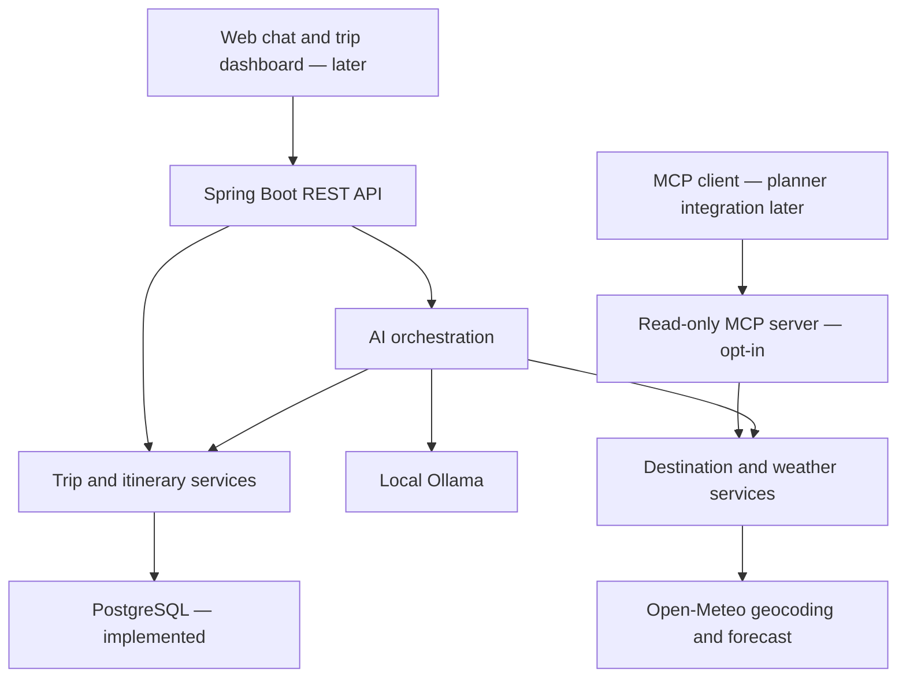

# AI Travel Planner: architecture and build plan

## Browser entry point

Spring Boot serves `static/index.html`, `chat.css` and `chat.js` at `/`.
The page posts a single question to the same-origin `/api/v1/ai/chat` endpoint
and renders model prose and tool evidence separately as plain text. It maintains
only a bounded in-page display, not model memory or persistent chat history.
No frontend build, new controller, database change or additional model capability.

## Model-directed read-only tools

`POST /api/v1/ai/chat` → `TravelAssistantService` → Ollama → validated tool request
→ `TravelMcpClient` → HTTP MCP server → existing services → model explanation.
This opt-in, stateless flow is separate from itinerary generation. It permits two
tool calls and three model rounds, with weather bound to the request's trip ID.
Returned tool evidence is separate from generated prose. No writes or chat memory.

## Explicit local MCP client

With `mcp-client`, `McpClientController` exposes tool discovery, destination search
and trip weather. `TravelMcpClient` opens a short-lived SDK session over loopback
HTTP to `/mcp` (requires `mcp`). Only two read-only tools are allowed; neither
server URL nor arbitrary tool name comes from the caller. This bridge does not
register model callbacks or alter itinerary generation. See lesson 13.

## Product goal

Help a traveler turn preferences into a practical, editable day-by-day itinerary.
Example: "Plan five days in Jaipur for two people within INR 50,000, with food
and history activities." The assistant asks about missing constraints, creates
a draft, and explains changes when the traveler revises it.

Initial product scope is planning. Booking, payments, visas, and autonomous
purchases are outside the initial scope. Live prices and availability must come
from providers; model-generated estimates will be labeled as estimates.

## Architectural choice

Use a **modular monolith**: one Spring Boot process and one Maven project, with
code grouped by feature. That means one app to run and debug, while keeping
trip management, itinerary generation, and integrations separate in code.
There is no need for an API gateway, service discovery, or message broker yet.

The diagram shows the target architecture. Lessons 1–3 implement the Spring Boot
foundation, status/health, and a create/read Trip API persisted in PostgreSQL
through JPA. Flyway manages the tables. Boxes are responsibilities;
they are not all separate deployment units.

Lesson 4, step 1 adds an opt-in Spring AI/Ollama connection test in package `ai`.
Step 2 adds a structured itinerary draft endpoint with server-side validation.
Validated drafts are now saved as immutable PostgreSQL JSONB snapshots. A separate
GET route reads the highest-ID saved snapshot without an AI dependency. An opt-in
read-only MCP server is now implemented; planner-side MCP client integration is future work.

The `destination` package now adds a direct, read-only Open-Meteo geocoding
integration via `GET /api/v1/destinations?name=...`. It returns candidate locations;
PUT/GET `/api/v1/trips/{tripId}/location` now persist a selected provider-backed
location using the V3 `trip_locations` table. New itinerary generation now uses
that selected location and snapshots it with the saved plan. It does not verify
attractions or call MCP. A separate GET `/api/v1/trips/{tripId}/weather`
now uses the selected coordinates and exact trip dates within a guarded 16-day
window. New itinerary generation now optionally supplies that forecast to the AI
and saves its source/time/data as `weatherContext`; missing forecasts are explicit
fallback statuses. Standalone weather GET does not modify existing itineraries.

The travel MCP server runs in the same Spring Boot application with the `mcp`
profile. Its two read-only tools wrap Java services. Keeping client and server roles distinct
lets us learn the protocol without immediately operating multiple services.
We can extract the server into its own module/process if another client needs it.

## Modules and ownership

All packages sit below `com.aibot.travelplanner` so Spring can discover them.
`system` and `trip` are created now. Future packages will be created with their first
working feature; there are no empty placeholder implementations.

| Package | Responsibility | State |
| --- | --- | --- |
| `system` | Application status response | Implemented |
| `trip` | Trip details, dates, budget, traveler preferences | Create/read, validation, and PostgreSQL persistence implemented |
| `itinerary` | Day plans, activities, validation, revisions | Validated snapshots, latest retrieval, paginated history and specific-version retrieval implemented; editing planned |
| `ai` | Conversation, prompts, model calls, MCP client, structured output | Weather/location-aware Ollama generation implemented; planner MCP client planned |
| `mcp` | MCP server tool definitions and transport configuration | Opt-in Streamable HTTP server with two read-only tools and local Host/Origin guard |
| `destination` / `weather` | External location, weather and travel API adapters | Destination geocoding/selection and trip-date weather implemented; attraction data planned |
| `security` | Sign-in and ownership checks | Planned before shared deployment |

Within a growing feature, add `api`, `application`, `domain`, and `infrastructure`
subpackages when needed. A controller handles HTTP; an application service runs
a use case; domain objects express travel rules; an adapter handles storage or
an external API. Controllers and MCP tools call the same services instead of
duplicating business rules. The current status endpoint needs no service layer.

## AI and MCP have different jobs

- **AI model:** interprets travel requests and drafts or revises an itinerary.
- **Spring AI orchestration:** assembles context, calls the model, and manages
  bounded tool calls. It checks structured model output before saving it.
- **MCP client:** discovers and calls tools exposed by connected MCP servers.
- **MCP server:** publishes specific typed tools, such as `searchPlaces` or
  `getWeatherForecast`, which delegate to our Java integration services.
- **Provider adapters:** actually call weather/places/travel APIs. MCP does not
  supply travel data, provider credentials, or permission to book anything.

An MCP server endpoint is a protocol endpoint, not merely a REST controller
with "MCP" in its name. We will add the Spring AI MCP starter and transport
configuration when implementing this milestone.

## Future itinerary request flow

1. The traveler supplies dates, destination, budget/currency, traveler count,
   and interests. The API validates these constraints.
2. The trip service stores the structured request.
3. AI orchestration loads that trip and any relevant conversation context.
4. When needed, the MCP client calls travel tools to obtain provider data.
5. The model returns a structured itinerary draft.
6. The itinerary service validates dates and budget calculations and records
   assumptions, source references, and provider retrieval times.
7. The traveler sees and edits the plan; accepted revisions are stored.

Missing provider data remains explicitly unavailable. Weather forecasts must
respect the provider's forecast horizon; a distant trip may only have climate
guidance. Tool results are data, not instructions to override application rules.

## Data design, when persistence is introduced

| Object | Core fields |
| --- | --- |
| Trip | ID, owner, origin, destination, start/end date, travelers, budget, currency, interests |
| Itinerary | ID, trip ID, revision, status, created time, assumptions |
| Itinerary day | Itinerary ID, local date, ordered activities |
| Activity | Place, local start/end time, estimated cost, source reference |
| Conversation message | Trip ID, role, content, timestamp |

Use `BigDecimal` for money with an explicit ISO currency code. Use `LocalDate`
for trip dates and destination-aware time zones for timed activities. Store
provider observations separately with their source and retrieval time. One
trip may have multiple itinerary revisions. PostgreSQL will be the durable
source of truth; a model's conversation context is not the database.

## Build milestones

| Lesson | Deliverable | Completion check |
| --- | --- | --- |
| 1 — Foundation | Spring Boot, status/health, learning docs | Start app; call both endpoints |
| 2 — Trip API | Create/read trips; validate dates and budgets; temporary in-memory store | Valid request succeeds; invalid request returns useful 400; explain restart data loss |
| 3 — Persistence | PostgreSQL, JPA, Flyway migrations | Trip remains after app restart |
| 4 — AI itinerary | Spring AI, selected model, structured draft output | Valid itinerary generated; model errors handled |
| 5 — MCP tools | MCP server/client, weather and places adapters | Tool discovery/call works; sources shown; timeouts handled |
| 6 — Product | Chat UI, sign-in, ownership, itinerary revision | Two users cannot read each other's trips |
| 7 — Deployment | Docker, CI, configuration, usage limits, monitoring | Reproducible deployed build and bounded provider usage |

Dependencies are added at the milestone that uses them. Provider selection,
quotas, and prices will be evaluated when we implement live data. Before shared
deployment, configure authentication, ownership checks, retention, secrets,
timeouts, and model/tool request limits. No microservice split is required by
this plan.

## Version decision

Lesson 1 pins Spring Boot 4.1.1 and Java 21. Spring AI's current documentation
states that 2.0.x supports Boot 4.0.x and 4.1.x. Lesson 4 pins Spring AI 2.0.1
and selects local Ollama `qwen3:4b`. Compatibility rechecked on 2026-10-03:

- [Spring Boot](https://spring.io/projects/spring-boot/)
- [Spring Boot system requirements](https://docs.spring.io/spring-boot/system-requirements.html)
- [Spring AI getting started](https://docs.spring.io/spring-ai/reference/getting-started.html)
- [Spring AI MCP guide](https://docs.spring.io/spring-ai/reference/guides/getting-started-mcp.html)
